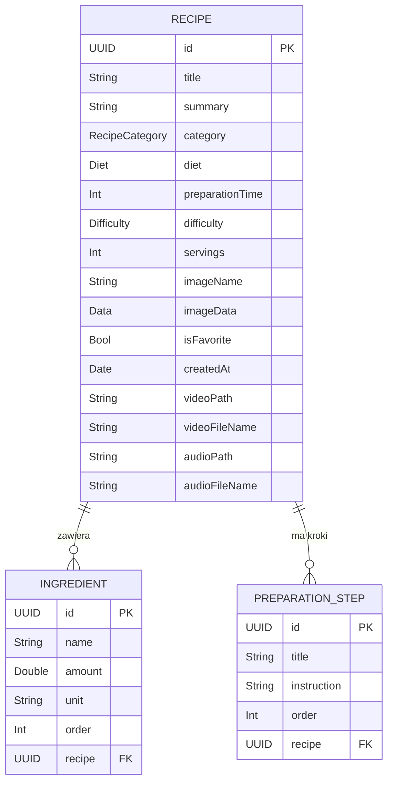

# Cookbook

Natywna książka kucharska w SwiftUI ze stałym lokalnym zapisem SwiftData.
Projekt zachowuje konfigurację z main: Xcode 27, deployment target iOS 27.0, iPhone i iPad.

## Stan weryfikacji po audycie 21.11.2026

Wykonano przegląd kodu i kontrole statyczne na Windows. Kompilacja Xcode,
wykonanie XCTest i wygląd/animacje na iOS **nie zostały jeszcze zweryfikowane**.
Przygotowano 29 testów logiki i integracji oraz 4 testy interfejsu.
Sam brak błędów parsera nie oznacza, że kompilacja i testy na iOS zakończą się powodzeniem.

- [Audyt i lista poprawek](Docs/AUDYT.md)
- [Struktura i działanie projektu](Docs/STRUKTURA_PROJEKTU.md)
- [Procedura testów i miejsce na wyniki z Maca](Docs/WERYFIKACJA.md)
- [Maszynowy raport kontroli statycznej](Docs/static-validation.json)

## Najważniejsze zachowania

- **Porcje:** ustawienie 1–12 określa początkową liczbę porcji w nowym przepisie
  i po otwarciu szczegółów. W szczegółach można wybrać 1–100 porcji na potrzeby
  bieżącego gotowania. Ta zmiana nie nadpisuje preferencji ani bazowych ilości w bazie.
  Edycja przepisu pokazuje jego własną bazową liczbę porcji.
- **Ulubione:** serce działa na liście i w szczegółach; zapis jest jawny, a przy
  błędzie stan jest cofany. Animacja uwzględnia ustawienie systemowe Ogranicz ruch.
- **Edycja i usuwanie:** przeciągnij wiersz w prawo. Usuwanie wymaga potwierdzenia.
  Edycja zachowuje tożsamość przepisu, datę utworzenia i polubienie.
- **Dane startowe:** 15 przykładowych przepisów dodaje się raz. Usunięcie całej
  książki nie powoduje odtworzenia przykładów przy kolejnym starcie.
- **Multimedia:** wybór własnego zdjęcia i załączników jest dostępny.
  Do Wrapa z kurczakiem dołączono film i poprawne nagranie WAV użytkownika.
  Oba pliki są dostępne offline. Szczegóły: [Multimedia](Docs/MULTIMEDIA.md).

Do końcowego zaliczenia pozostaje uruchomienie na urządzeniu iOS, udokumentowanie
wyników testów oraz sprawdzenie odtwarzania dołączonego filmu i audio.

## Pochodzenie

Baza robocza: lokalny folder pobrany z `moshenetsb/Cookbook`, po integracji SwiftData.
Kontekst porównania: [scalenie SwiftData](https://github.com/moshenetsb/Cookbook/commit/25e1b3faa478107ca0e612b5994bc161e2fc8b11)
oraz [wcześniejsza integracja interfejsu](https://github.com/moshenetsb/Cookbook/commit/a52c75570b559d15fba37181c06e445f7b92a3f0).
Poprawki z audytu przygotowano lokalnie; nie publikowano ich w GitHub.

## Schemat bazy danych

Dane przepisów są przechowywane lokalnie przez `SwiftData`. Usunięcie przepisu usuwa również powiązane składniki i kroki przygotowania.

